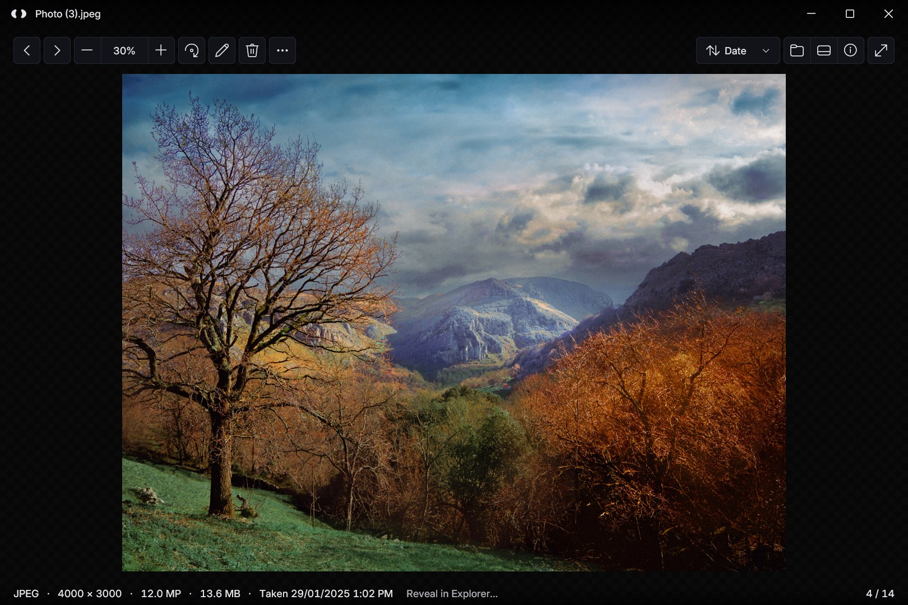
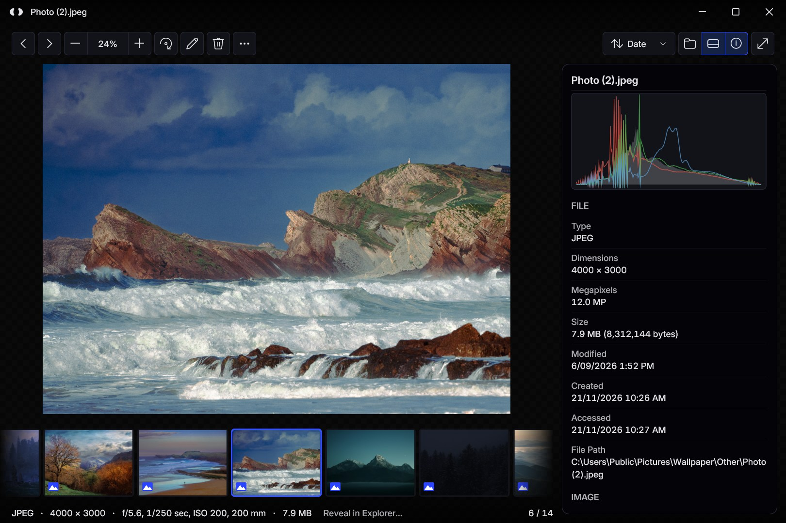
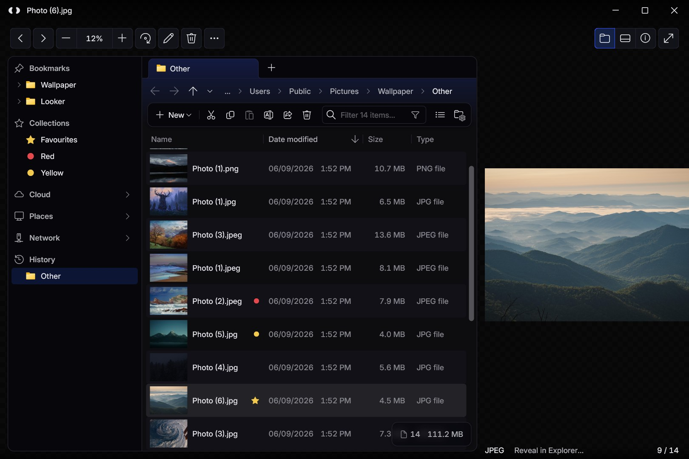
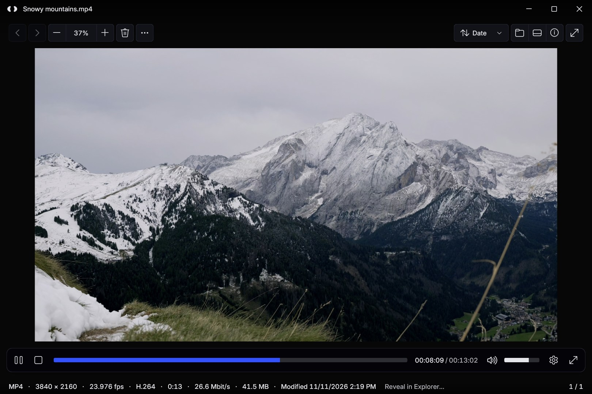
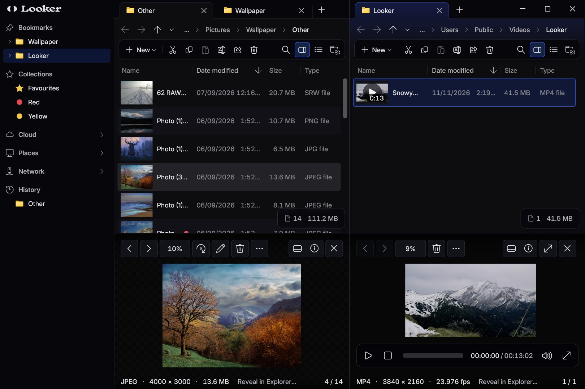

  <picture>
    <source media="(prefers-color-scheme: dark)" srcset="brand/slices/looker_v4_full_white.png">
    
  </picture>

A fast photo and file viewer for Windows 11, with a file explorer built in. Free, and Looker Pro makes it your
File Explorer.

<a href="https://apps.microsoft.com/detail/9NV130N4C2GZ?mode=direct">
  <picture>
    <source media="(prefers-color-scheme: dark)" srcset="https://get.microsoft.com/images/en-us%20light.svg">
    
  </picture>
</a>

Or open `Looker.appinstaller` from the [latest release](https://github.com/fayewave/Looker/releases/latest); it
keeps itself up to date.

## Viewer

- Opens in a blink, with the next files in the folder already loaded.
- Photos, camera RAW, video, audio, PDFs, archives, 3D models and code: 288 file types.
- Zoom up to 25600 %, fullscreen, slideshow and a thumbnail strip.
- Info panel with EXIF and a histogram; edit titles, keywords and ratings.
- Crop, straighten, and adjust light and colour (`E`).
- Colour managed; HDR photos and video at full brightness on an HDR display.
- Black, Paper and Light themes. Works with screen readers.

## File explorer

- Beside the photo, with tabs, bookmarks, colour tags and thumbnails.
- Move, copy, rename and delete with undo; drag to and from other apps.
- Filter a folder by field: `camera:x100`, `rating:4+`, `taken:2024`.

## Video and audio

- 4K and HDR video, frame stepping, chapters, and subtitles of every kind.
- Audio with its cover, a waveform or spectrogram, and loops.
- iPhone Live Photos and Android motion photos play.

## Text and code

- A tabbed editor with find and replace, spell check and Markdown.
- Code coloured in 20+ languages; JSON, XML, YAML, TOML and CSV checked as you type.

## Looker Pro

**Looker Pro** (US$19.99 once, two PCs, every Looker 3 update) opens folders, drives and Win+E in Looker instead
of File Explorer.

- Opens in under a tenth of a second and lists 100,000 files almost instantly.
- Up to twelve panes side by side, each with its own preview.
- Instant search across your drives.
- The Recycle Bin, phones and cameras, and Windows' own right-click menu items.
- Batch rename, ZIP and 7z, folder sizes, and every File Explorer view.

Get it on [veil.page](https://veil.page/looker/buy), then paste the key into Settings > Looker Pro.

## Formats

All 288 file types

- **Images:** JPEG, PNG, APNG, GIF, WebP, BMP, TIFF, HEIC, AVIF, JPEG XL, JPEG XR, JPEG 2000, SVG, ICO, PSD, XCF,
  TGA, DDS, VTF, PCX, Netpbm, QOI, OpenEXR, Radiance HDR
- **Camera RAW:** Canon, Nikon, Sony, Fujifilm, Panasonic, Olympus, Pentax, Samsung, Leica, Hasselblad, Phase One,
  Minolta, Kodak, Epson, Mamiya, DNG
- **Video:** MP4, MOV, MKV, WebM, AVI, WMV, MPEG-TS and M2TS, MPEG and VOB, MXF, 3GP, FLV, Ogg, RealMedia, DV,
  raw H.264/HEVC/VVC streams and dozens of game formats; every common codec, ProRes and DNxHR included
- **Audio:** MP3, AAC, M4A, FLAC, WAV, AIFF, Ogg, Opus, WMA, ALAC, WavPack, Monkey's Audio, Dolby, DTS, DSD, MIDI,
  tracker modules and game audio
- **Subtitles:** SRT, ASS/SSA, WebVTT, PGS, VobSub, DVB, teletext, closed captions and more
- **Archives:** ZIP, 7z, RAR, TAR, gzip, bzip2, xz, Zstandard, CAB, ISO, comic books
- **Documents:** PDF, text, Markdown, JSON, XML, YAML, TOML, INI, CSV and source code
- **3D:** OBJ, STL, PLY, 3MF, glTF

## Keys

| Key | Action |
|---|---|
| `←` `→` | Previous / next |
| Wheel, `Ctrl+0`, `Ctrl+1` | Zoom, fit, 100 % |
| `F11`, `F5`, `Space` | Fullscreen, slideshow, play / pause |
| `Ctrl+E`, `Ctrl+I`, `Ctrl+Shift+T` | File explorer, info panel, thumbnails |
| `E`, `Ctrl+R` | Edit, rotate |
| `Delete`, `F2` | Delete, rename |
| `Ctrl+,` | Settings |
