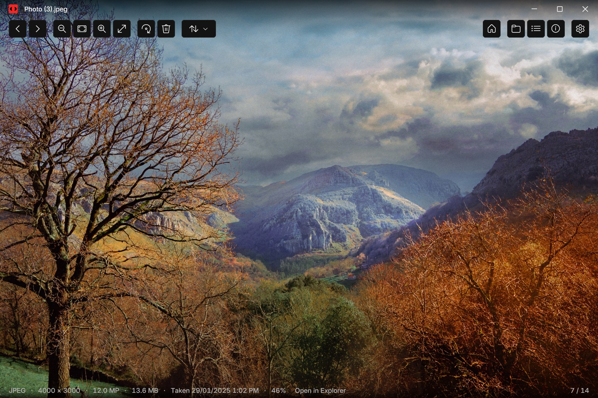
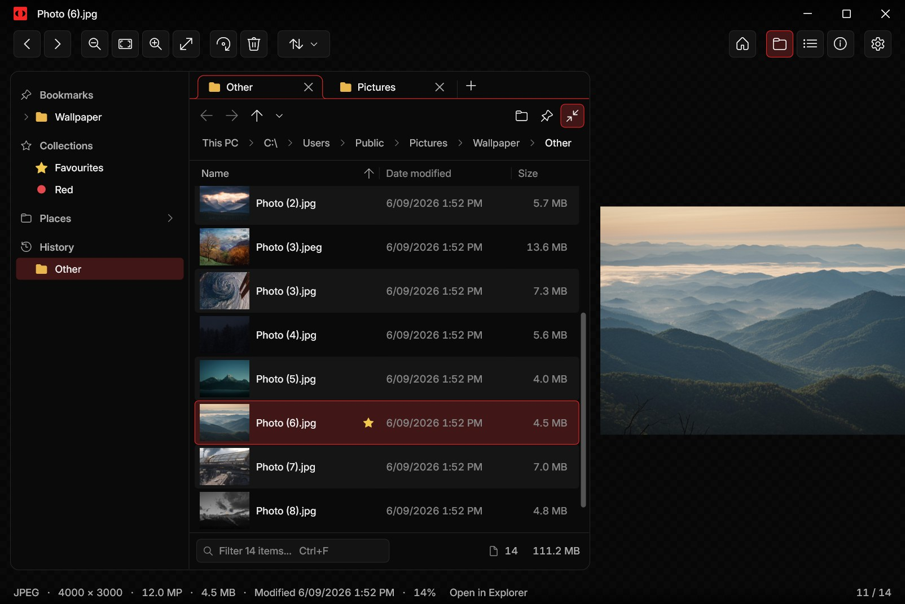

<p align="left">
  
</p>

A fast, minimal photo and file viewer for Windows 11, with a proper file explorer built in.

<a href="https://apps.microsoft.com/detail/9NV130N4C2GZ?mode=direct">
  <picture>
    <source media="(prefers-color-scheme: dark)" srcset="https://get.microsoft.com/images/en-us%20light.svg">
    
  </picture>
</a>

Or from the [latest release](https://github.com/fayewave/Looker/releases/latest): open `Looker.appinstaller` and
it keeps itself up to date.



## File explorer

- Beside the photo, or across the window with the photo as a preview (`B`).
- Tabs, and a sidebar of Bookmarks, Collections, History and Places.
- Sortable, resizable columns: date taken, camera, lens, dimensions and more.
- Thumbnails at any row height, subfolders listed flat, a saved view per folder.
- Move, copy, rename, delete and new folder, with undo. Drag onto folders and tabs, or out to other apps.
- Favourites and colour tags.



## Viewer

- Opens straight into the file; the next files in the folder are already loaded.
- Zoom at the pointer up to 3200 %, fullscreen, slideshow, thumbnail strip.
- Info panel with EXIF and a histogram.
- Rotate, rename, copy, set as wallpaper, show in File Explorer.
- Colour managed, wide gamut included; HDR photos at full brightness on an HDR display.
- Animated GIF, WebP and APNG play. PDFs open as a row of pages. 3D models open in a live view.


## Formats

- **Images:** JPEG, PNG/APNG, GIF, BMP, TIFF, WebP, ICO/CUR, JPEG XR, JPEG 2000, HEIC/HEIF, AVIF, JPEG XL, SVG,
  PSD/PSB, TGA, DDS, PCX, PPM/PGM/PBM, XCF, QOI
- **Camera RAW:** CR2, CR3, CRW, NEF, NRW, ARW, SR2, SRF, DNG, ORF, RAF, RW2, PEF, SRW, 3FR, FFF, RWL, IIQ, MRW, DCR,
  KDC, ERF, MEF
- **Documents:** PDF
- **3D:** OBJ (with MTL), STL, PLY, 3MF, glTF/GLB; MTL material libraries

## Keys

| Key | Action |
|---|---|
| `←` `→`, `Home` `End` | Previous / next, first / last |
| Wheel, `Ctrl` `+` `-` | Zoom at the pointer |
| `F`, `1`, double-click | Fit, 100 %, toggle |
| `E`, `B`, `T`, `I` | File explorer, browse mode, thumbnail strip, info panel |
| `Ctrl+T`, `Ctrl+W`, `Ctrl+Tab` | New tab, close tab, next tab |
| `Ctrl+F`, `Ctrl+Z` | Filter the folder, undo |
| `F11`, `F5`, `Space` | Fullscreen, slideshow, pause |
| `Delete`, `F2` | Delete, rename |
| `Ctrl+R`, `Ctrl+S` | Rotate, save rotation |
| `Ctrl+C`, `Ctrl+Shift+C`, `Ctrl+E` | Copy image, copy path, show in File Explorer |
| `Ctrl+,` | Settings |

## Build

Windows 11, Rust (stable, MSVC), the Windows SDK and Developer Mode.

```powershell
cd native; cargo build --release; cargo test --release; cd ..
pwsh scripts/Publish-Native.ps1                # install the build as the Looker package
pwsh scripts/Build-NativePackage.ps1 -Store    # Microsoft Store upload
```

Native Rust: Direct2D and DirectWrite, images through WIC, 3D through Direct3D 11.
