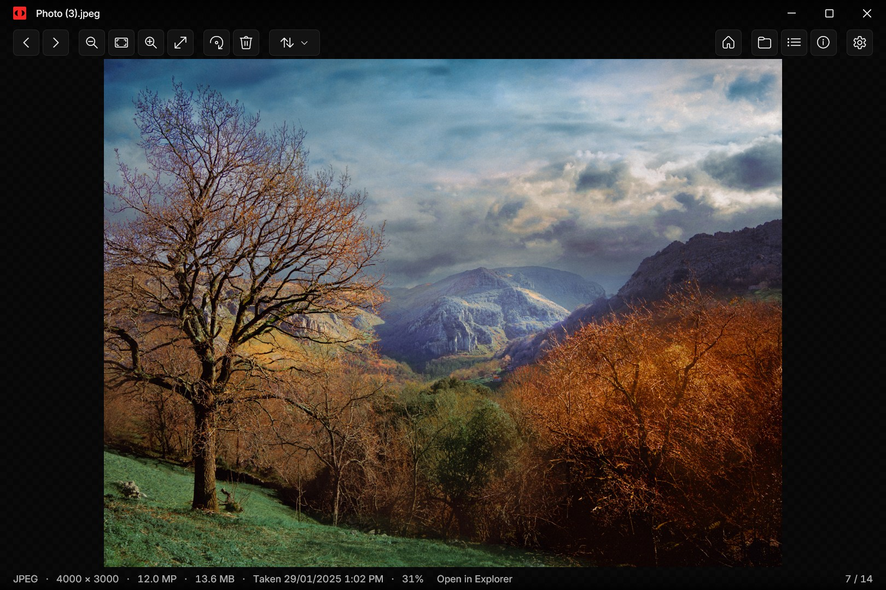
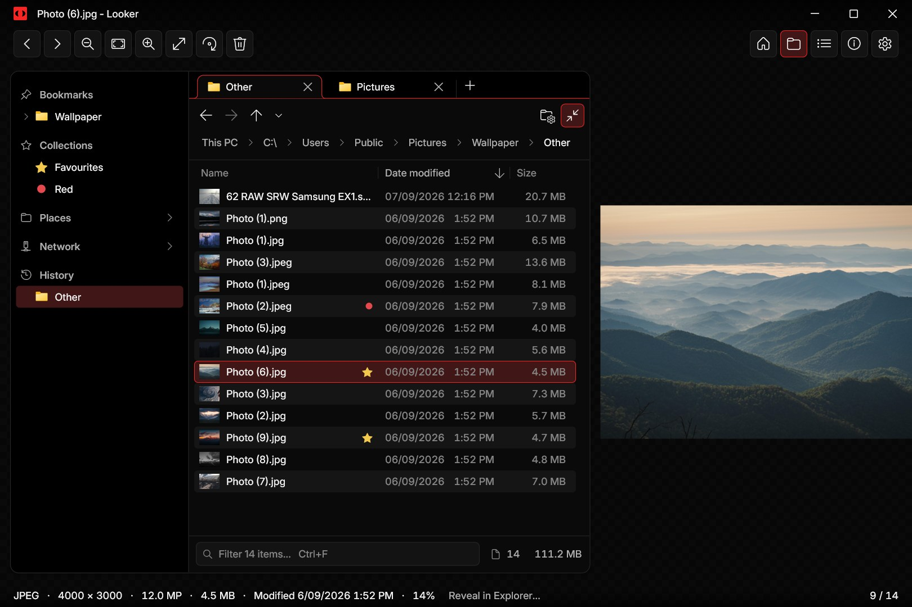
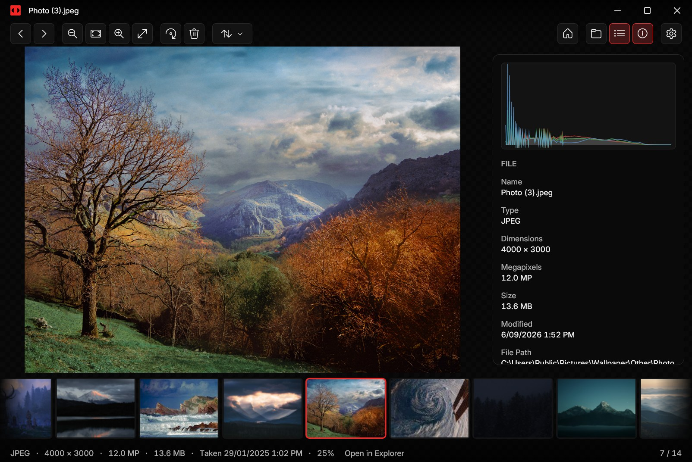
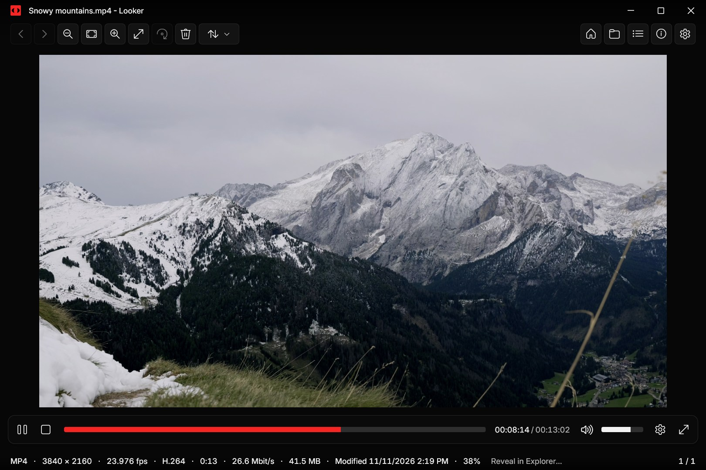
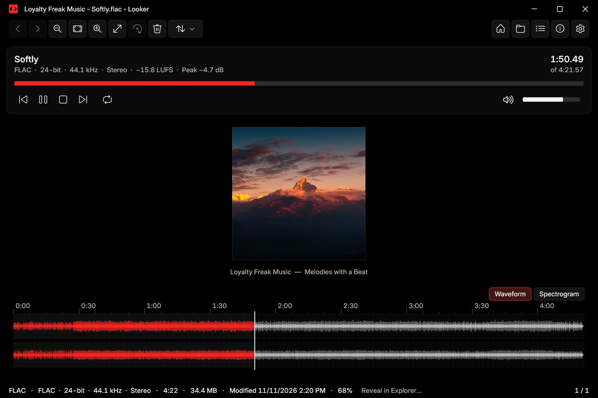
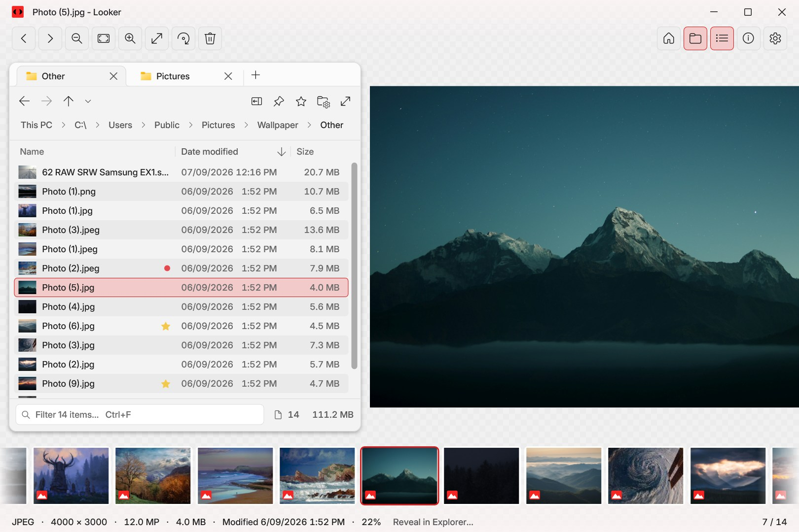

<p align="left">
  
</p>

A fast, minimal photo and file viewer for Windows 11, with a proper file explorer built in.

<a href="https://apps.microsoft.com/detail/9NV130N4C2GZ?mode=direct">
  <picture>
    <source media="(prefers-color-scheme: dark)" srcset="https://get.microsoft.com/images/en-us%20light.svg">
    
  </picture>
</a>

Or from the [latest release](https://github.com/fayewave/Looker/releases/latest): open `Looker.appinstaller` and
it keeps itself up to date.

---



## File explorer

- Beside the photo, or across the window with the photo as a preview (`Ctrl+B`).
- Windows' own folder and drive icons; type a letter to jump to a name.
- Tabs, and a sidebar of Bookmarks, Collections, History and Places.
- Sortable, resizable columns: date taken, camera, lens, dimensions and more.
- Thumbnails at any row height, subfolders listed flat, a saved view per folder.
- Move, copy, rename, delete and new folder, with undo. Drag onto folders and tabs, or out to other apps.
- Favourites and colour tags.



## Viewer

- Opens straight into the file; the next files in the folder are already loaded.
- Zoom at the pointer up to 25600 %, with crisp pixels from 100 % up; drag to pan, at fit too.
- Fullscreen, slideshow, thumbnail strip; the mouse's Back and Forward buttons step through the files you've viewed.
- Info panel with EXIF, a histogram and a summary of several selected files; edit titles, captions, keywords,
  ratings, author and copyright in JPEG, TIFF, PNG and HEIC, one file or a whole selection at once.
- Filter a folder by field: `keyword:beach`, `camera:x100`, `rating:4+`, `taken:2024`, `ext:png`.
- Rotate, rename, copy, set as wallpaper, show in File Explorer.
- Colour managed, wide gamut included; HDR photos at full brightness on an HDR display.
- Animated GIF, WebP and APNG play. PDFs open as a row of pages. 3D models open in a live view.
- Four themes (Black, Dark, Paper, Light) that can follow Windows, and any accent colour.



## Video and audio

- Videos play, HDR and 4K60 included, with frame stepping, frame-accurate scrubbing, a timecode or frame count,
  and the media keys and taskbar progress; subtitles from the file itself (SRT, ASS/SSA with its styling and
  fonts, WebVTT, MP4 timed text, PGS, VobSub, DVB, teletext, ARIB) or from files beside it, in any encoding.
- Chapters marked on the seek bar, listed in the bar's Settings menu, and `Shift+N` / `Shift+P` to move between
  them; interlaced video (DVDs, camcorders, TV recordings) deinterlaced as it plays; Dolby and DTS sound can go
  undecoded to a receiver (Passthrough, in the bar's Settings).
- Audio files play with their cover, tags and a waveform (or spectrogram) per channel: click to seek, drag to loop
  a part, Ctrl+wheel to zoom; loudness in LUFS.
- Live Photos (iPhone Live Photos, Google and Samsung motion photos): the Live Photo button opens the clip with
  the full video controls, and holding the mouse on the photo plays it.
- Rip unprotected DVDs to MKV or MP4.





## Text editor

- Text files open in a tabbed editor with a File/Edit/View menu bar, find and replace, spell check, Markdown and
  printing; big files scroll smoothly, and open tabs come back next time.
- Works with screen readers.



## Formats

Every file type Looker opens (288 extensions), and every video, audio and subtitle codec it plays inside them.

### Images

| Format | Extensions |
|---|---|
| JPEG | `.jpg` `.jpeg` `.jpe` `.jfif` |
| PNG, APNG (animated) | `.png` `.apng` |
| GIF (animated) | `.gif` |
| WebP (animated) | `.webp` |
| BMP | `.bmp` `.dib` |
| TIFF | `.tif` `.tiff` |
| HEIC / HEIF | `.heic` `.heif` `.hif` `.heics` |
| AVIF (animated) | `.avif` `.avifs` |
| JPEG XL | `.jxl` |
| JPEG XR | `.jxr` `.wdp` `.hdp` |
| JPEG 2000 | `.jp2` `.j2k` `.jpf` `.jpx` `.j2c` |
| SVG | `.svg` `.svgz` |
| Icon, cursor | `.ico` `.cur` |
| Photoshop | `.psd` `.psb` |
| GIMP | `.xcf` |
| Targa | `.tga` `.icb` `.vda` `.vst` |
| DirectDraw Surface | `.dds` |
| Valve Texture | `.vtf` |
| PCX | `.pcx` |
| Netpbm | `.pnm` `.ppm` `.pgm` `.pbm` |
| QOI | `.qoi` |
| OpenEXR | `.exr` |
| Radiance HDR | `.hdr` |

### Camera RAW

| Camera | Extensions |
|---|---|
| Canon | `.cr2` `.cr3` `.crw` |
| Nikon | `.nef` `.nrw` |
| Sony | `.arw` `.sr2` `.srf` |
| Fujifilm | `.raf` |
| Panasonic | `.rw2` |
| Olympus, OM System | `.orf` |
| Pentax | `.pef` |
| Samsung | `.srw` |
| Leica | `.rwl` |
| Hasselblad | `.3fr` `.fff` |
| Phase One | `.iiq` |
| Minolta | `.mrw` |
| Kodak | `.dcr` `.kdc` |
| Epson | `.erf` |
| Mamiya | `.mef` |
| Adobe DNG (any camera) | `.dng` |

### Video files

| Format | Extensions |
|---|---|
| MPEG-4 | `.mp4` `.m4v` |
| QuickTime | `.mov` |
| Matroska | `.mkv` |
| WebM | `.webm` |
| AVI (DivX, Xvid) | `.avi` `.divx` `.xvid` |
| Windows Media | `.wmv` `.asf` |
| MPEG transport stream (Blu-ray, AVCHD, TV) | `.ts` `.mts` `.m2ts` `.m2t` `.trp` `.tp` |
| MPEG program stream (DVD, camcorders) | `.mpg` `.mpeg` `.mpe` `.m2p` `.vob` `.mod` `.tod` |
| MPEG video stream | `.m1v` `.m2v` `.mpv` |
| MXF | `.mxf` |
| 3GPP | `.3gp` `.3g2` |
| Flash Video | `.flv` `.f4v` |
| Ogg video | `.ogv` `.ogm` |
| RealMedia | `.rm` `.rmvb` |
| DV | `.dv` |
| Windows Media Center | `.wtv` `.dvr-ms` |
| Nullsoft Video | `.nsv` |
| NuppelVideo | `.nuv` |
| GXF | `.gxf` |
| YUV4MPEG | `.y4m` |
| IVF, AV1 bitstream | `.ivf` `.obu` |
| H.264 stream | `.264` `.h264` |
| HEVC stream | `.265` `.hevc` |
| H.266 / VVC stream | `.266` `.vvc` |
| Bink | `.bik` |
| Smacker | `.smk` |
| id Software RoQ | `.roq` |
| Westwood VQA | `.vqa` |
| PlayStation STR | `.str` |
| 4X Movie | `.4xm` |
| LucasArts SMUSH | `.san` `.snm` |
| Nintendo THP | `.thp` |
| Sega FILM | `.cpk` `.film` |
| Interplay MVE | `.mve` |
| Sierra VMD | `.vmd` |
| American Laser Games MM | `.mm` |
| Electronic Arts | `.tgv` `.tgq` `.mad` `.wve` |
| Xbox XMV | `.xmv` |
| Cryo HNM | `.hnm` |
| Escape RPL | `.rpl` |
| DXA | `.dxa` |
| Autodesk FLIC | `.fli` `.flc` |
| Bitmap Brothers JV | `.jv` |
| RL2 | `.rl2` |
| BFI | `.bfi` |
| Amiga CDXL | `.cdxl` |
| Amazing Studio PAF | `.paf` |
| YOP | `.yop` |
| Motion Pixels | `.mvi` |

### Video codecs

| Kind | Codecs |
|---|---|
| Modern | H.264 / AVC, H.265 / HEVC, H.266 / VVC, AV1, VP8, VP9 (H.264, HEVC, VP9, AV1, MPEG-2 and VC-1 decode on the GPU) |
| MPEG | MPEG-1, MPEG-2, MPEG-4 Part 2 (DivX, Xvid), H.263, H.261 |
| Microsoft | WMV 7, 8 and 9, VC-1, MS-MPEG-4 v1, v2 and v3, Video 1, RLE, Screen 1 and 2 |
| Professional | Apple ProRes, Avid DNxHD / DNxHR, GoPro CineForm, JPEG 2000, Dirac, DV, HAP, Resolume DXV, Motion JPEG (A and B), QuickTime Animation, uncompressed (v210, v210x, r210, r10k, bitpacked, raw) |
| Lossless and capture | FFV1, HuffYUV, FFVHuff, Ut Video, MagicYUV, Lagarith, Fraps, Canopus Lossless, Canopus HQ / HQA / HQX, ZMBV, LCL (zlib, MSZH), 8BPS, PNG |
| Screen recording | TechSmith Camtasia (TSCC, TSCC2), Flash Screen Video 1 and 2, VMware VNC |
| Older | Cinepak, Indeo 2, 3, 4 and 5, Sorenson Video 1 and 3, On2 VP3, VP4, VP5, VP6 and VP7, Duck TrueMotion 1 and 2, Theora, Sorenson Spark (Flash), RealVideo 1, 2, 3 and 4, Apple Video, Apple Graphics, Bink Video, Smacker |
| Games | id RoQ, Westwood VQA, PlayStation MDEC, 4X, LucasArts SMUSH, Interplay, Sierra VMD, American Laser Games MM, Electronic Arts CMV / MAD / TGQ / TGV / TQI, Wing Commander III, Cryo HNM4, Escape 124 and 130, DXA, Autodesk FLIC, Bitmap Brothers JV, RL2, BFI, Amiga CDXL, PAF, YOP, Motion Pixels, Kega Game Video |

### Audio files

| Format | Extensions |
|---|---|
| MP3 | `.mp3` |
| MPEG audio layer 1 and 2 | `.mp1` `.mp2` `.mpa` |
| AAC | `.aac` |
| MPEG-4 audio, audiobooks | `.m4a` `.m4b` |
| FLAC | `.flac` |
| WAV | `.wav` |
| Wave64 | `.w64` |
| AIFF | `.aif` `.aiff` |
| Ogg (Vorbis, Opus, Speex, FLAC) | `.ogg` `.oga` `.opus` |
| Windows Media Audio | `.wma` `.xwma` |
| Matroska audio | `.mka` |
| WebM audio | `.weba` |
| WavPack | `.wv` |
| Monkey's Audio | `.ape` |
| Core Audio | `.caf` |
| Dolby Digital | `.ac3` `.eac3` |
| DTS | `.dts` |
| Dolby TrueHD, MLP | `.thd` `.mlp` |
| Musepack | `.mpc` |
| TTA | `.tta` |
| TAK | `.tak` |
| Shorten | `.shn` |
| AMR | `.amr` `.awb` |
| Sun / NeXT | `.au` `.snd` |
| Creative Voice | `.voc` |
| GSM | `.gsm` |
| DSD | `.dsf` `.dff` |
| RealAudio | `.ra` |
| MIDI (played with the GeneralUser GS sound bank) | `.mid` `.midi` `.rmi` `.kar` |
| Tracker modules | `.mod` `.xm` `.it` `.s3m` `.mptm` `.stm` `.669` `.mtm` `.med` `.okt` `.far` `.ult` `.umx` `.mo3` `.dmf` `.amf` `.psm` `.j2b` `.dsm` |
| CRI HCA, ADX | `.hca` `.adx` |
| Sony VAG, XVAG, ADS, MSF | `.vag` `.xvag` `.ads` `.ss2` `.msf` |
| Nintendo streams | `.brstm` `.bfstm` `.bcstm` `.ast` |
| GENH | `.genh` |
| CD-XA | `.xa` |
| APM | `.apm` |
| Bluetooth SBC, aptX | `.sbc` `.aptx` `.aptxhd` |
| QCELP | `.qcp` |
| Olympus DSS | `.dss` |
| IAMF | `.iamf` |
| QOA | `.qoa` |
| LC3 | `.lc3` |

`.mod` is also a camcorder video: Looker looks inside to tell which.

### Audio codecs

| Kind | Codecs |
|---|---|
| Common | AAC (and LATM), MP1, MP2, MP3, Opus, Vorbis, Speex, FLAC, ALAC |
| Surround | Dolby Digital (AC-3), Dolby Digital Plus (E-AC-3), Dolby TrueHD, MLP, Dolby E, DTS (and DTS-HD); Dolby and DTS can pass through to a receiver |
| Windows Media | WMA 1 and 2, WMA Pro, WMA Lossless, WMA Voice, xWMA (XMA 1 and 2) |
| Lossless | WavPack, Monkey's Audio, TTA, TAK, Shorten, RealAudio Lossless |
| DSD | DSD (DSF, DFF), DST |
| PCM | 8 to 64-bit integer and 16 to 64-bit float, either byte order, planar, μ-law, A-law, DVD, Blu-ray, SMPTE 302M, LXF, VIDC |
| ADPCM | Microsoft, IMA (WAV, QuickTime, DK3, DK4, Westwood, AMV, SMJPEG, OKI, APC, Xbox, APM, SSI, Cunning, RAD), G.722, G.726, Yamaha, Creative, Flash, 4X, CRI ADX, Electronic Arts (and R1, R2, R3, XAS), CD-XA, Nintendo THP, AFC, DTK, MTAF, PlayStation |
| Speech | AMR-NB, AMR-WB, GSM, GSM (Microsoft), G.723.1, G.729, QCELP, EVRC, Olympus DSS SP, DSP Group TrueSpeech, Nellymoser, comfort noise |
| Older | Musepack 7 and 8, QDesign QDM2 and QDMC, MACE 3 and 6, Intel Music Coder, RealAudio (Cook, SIPR, 14.4, 28.8), Sony ATRAC 1, 3, 3+ and 9, DV audio |
| Bluetooth and new | SBC, aptX, aptX HD, LC3, IAMF, QOA |
| Games | CRI HCA, Bink Audio, Smacker audio, id RoQ DPCM, Interplay DPCM and ACM, Wing Commander III DPCM, SDX2 DPCM, Westwood SND1, LucasArts VIMA, Sierra VMD audio, Amazing Studio PAF audio |

### Subtitles

From inside the video or from a file beside it, in any text encoding.

| Kind | Formats |
|---|---|
| Text | SubRip (SRT), ASS / SSA (with their styling and fonts), WebVTT, MP4 timed text, MicroDVD, SubViewer 1 and 2, SAMI, MPL2, VPlayer, RealText, PJS, JACOsub, Spruce STL, plain text |
| Pictures | Blu-ray PGS, DVD VobSub, DVB, DivX XSUB, Blu-ray text (HDMV) |
| Broadcast | Closed captions (CEA-608), teletext, ARIB captions |

### Archives

Browse what's inside, open a file, extract all or a selection.

| Format | Extensions |
|---|---|
| ZIP | `.zip` |
| 7-Zip | `.7z` |
| RAR | `.rar` |
| TAR | `.tar` |
| gzip (and `.tar.gz`) | `.gz` `.tgz` |
| bzip2 (and `.tar.bz2`) | `.bz2` `.tbz2` `.tbz` |
| xz (and `.tar.xz`) | `.xz` `.txz` |
| Zstandard (and `.tar.zst`) | `.zst` `.tzst` |
| LZ4 | `.lz4` |
| Cabinet | `.cab` |
| Disc image | `.iso` |
| cpio | `.cpio` |
| LHA | `.lzh` `.lha` |
| Comic book | `.cbz` `.cbr` `.cb7` |

### Documents and text

| Format | Extensions |
|---|---|
| PDF | `.pdf` |
| Plain text | `.txt` |
| Markdown | `.md` `.markdown` |
| Logs | `.log` |
| Settings | `.ini` `.cfg` `.toml` `.yaml` `.yml` |
| Data | `.json` `.xml` `.csv` `.tsv` |
| Subtitles (as text) | `.srt` `.vtt` `.ass` `.ssa` |
| NFO | `.nfo` |
| Valve Source configs, materials, maps and model scripts | `.vdf` `.vmt` `.vmf` `.qc` |

A `.ts` that's TypeScript rather than video opens as text.

### 3D

| Format | Extensions |
|---|---|
| Wavefront OBJ (with its MTL materials) | `.obj` |
| STL | `.stl` |
| PLY | `.ply` |
| 3MF | `.3mf` |
| glTF | `.gltf` `.glb` |
| Material library (as material cards) | `.mtl` |

## Keys

| Key | Action |
|---|---|
| `←` `→`, `Home` `End` | Previous / next, first / last |
| Wheel, `Ctrl` `+` `-` | Zoom at the pointer |
| `Ctrl+0`, `Ctrl+1`, double-click | Fit, 100 %, toggle |
| `Ctrl+E`, `Ctrl+B`, `Ctrl+Shift+T`, `Ctrl+I` | File explorer, browse mode, thumbnail strip, info panel |
| A letter (in the file explorer) | Jump to the next name starting with it |
| `Ctrl+T`, `Ctrl+W`, `Ctrl+Tab` | New tab, close tab, next tab |
| `Ctrl+F`, `Ctrl+Z` | Filter the folder, undo |
| `F11`, `F5`, `Space` | Fullscreen, slideshow, pause |
| `,` `.`, `J` `K` `L`, `M` | Video: previous / next frame, slower / pause / faster, mute |
| `V`, `G` `H` | Video: next subtitle track, subtitles 50 ms earlier / later |
| `Shift+N`, `Shift+P` | Video: next / previous chapter |
| `Delete`, `F2` | Delete, rename |
| `Ctrl+R`, `Ctrl+S` | Rotate, save rotation |
| `Ctrl+C`, `Ctrl+Shift+C`, `Ctrl+Shift+E` | Copy image, copy path, show in File Explorer |
| `Ctrl+,` | Settings |

## Build

Windows 11, Rust (stable, MSVC), the Windows SDK and Developer Mode.

```powershell
cd native; cargo build --release; cargo test --release; cd ..
pwsh scripts/Publish-Native.ps1                # install the build as the Looker package
pwsh scripts/Build-NativePackage.ps1 -Store    # Microsoft Store upload
```

Native Rust: Direct2D and DirectWrite, images through WIC, video through FFmpeg, 3D through Direct3D 11.
